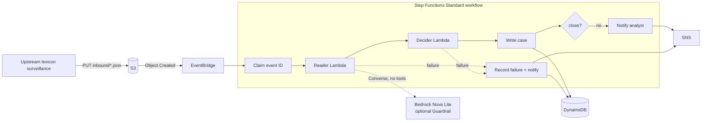

# Design document: Comms Surveillance Triage

| | |
| --- | --- |
| Status | Accepted, v0.1 |
| Author and owner | Manasa Ranjan Behera |
| Last updated | 2026-10-13 |
| Decision records | [ADR 0001](adr/0001-quarantined-reader-deterministic-decider.md) to [ADR 0006](adr/0006-cost-controls.md) |

## 1. Summary

Corvane Markets' surveillance analysts review employee chats that upstream lexicon rules have already flagged. Most flagged chats are routine, and the queue grows faster than the team. This service gives every flagged conversation a first-pass triage — **escalate**, **close** or **human review** — with the evidence and reasons behind it, so analysts start with the conversations most likely to matter.

The defining constraint is that **the input is written by the people under review**. Anyone who knows an automated reviewer exists can write instructions to it inside the chat. The design treats every transcript as hostile input, keeps the model away from any capability that could act on such instructions, and makes the attempt itself a reason to escalate.

## 2. Goals and non-goals

**Goals**

- G1: No conversation that should be escalated is closed automatically, including ones that contain instructions aimed at the reviewer.
- G2: Every disposition is explainable: which rule fired, on which message, with which quote.
- G3: Every disposition is reproducible: prompt, policy and model versions are recorded with it.
- G4: Unit cost is measured per conversation and stays at a fraction of a cent.
- G5: Any failure routes the conversation to a human, never silently drops or closes it.

**Non-goals**

- Making final regulatory determinations. An analyst always owns the outcome of an escalation.
- Replacing upstream lexicon surveillance. This service consumes its output.
- Voice, email or attachments in v0.1. The schema has a `channel` field to allow them later.
- Real-time blocking of messages.

## 3. Requirements

| ID | Requirement | How it is met |
| --- | --- | --- |
| F1 | Accept one conversation per S3 object under `inbound/` | EventBridge rule on `inbound/*.json` |
| F2 | Produce `escalate`, `close` or `human_review` with reasons | `policy.decide` |
| F3 | Notify analysts for anything not closed | SNS from the state machine |
| F4 | Keep an append-only case history | DynamoDB with key (`conversation_id`, `decided_at`) |
| N1 | An instruction inside a transcript cannot change an outcome | [ADR 0001](adr/0001-quarantined-reader-deterministic-decider.md) |
| N2 | Fail closed | [ADR 0004](adr/0004-fail-closed-dispositions.md) |
| N3 | Process each event exactly once in effect | Event-ID claim, [ADR 0005](adr/0005-case-store-audit-idempotency.md) |
| N4 | Bounded cost per conversation and per month | Input limits, token cap, concurrency cap, [ADR 0006](adr/0006-cost-controls.md) |
| N5 | Least privilege per component | Separate IAM roles per Lambda and for the state machine |
| N6 | No communications content in logs or alerts | Logs and SNS carry IDs, reasons and counts only |

## 4. Architecture

### 4.1 Processing stages

| Stage | Component | Sees transcript | Can call a model | Can write or notify |
| --- | --- | --- | --- | --- |
| Claim | Step Functions → DynamoDB | No | No | Claim record only |
| Prescreen | Reader Lambda, `prescreen.py` | Yes | No | No |
| Read | Reader Lambda, `reader.py` | Yes | Yes, no tools | No |
| Decide | Decider Lambda, `policy.py` | **No** | **No** | No |
| Record and notify | Step Functions direct integrations | No | No | Yes |

The only component that touches hostile text **and** a model has no tools and no write permissions. The component that decides has neither the text nor a model.

### 4.2 Reader contract

Input: the rendered transcript inside `<transcript>` tags, with any tag-like text in messages neutralised. When a Guardrail is configured, the transcript is sent as `guardContent` so that only the untrusted text is screened.

Output (`ReaderFindings`), validated by Pydantic:

| Field | Constraint |
| --- | --- |
| `summary` | ≤ 800 characters |
| `indicators[]` | ≤ 20; each has `category` (closed enum), `message_index` and `evidence` |
| `ai_directed_instruction` | boolean |
| `ai_directed_message_indices[]` | integers |

Each indicator's `evidence` must appear verbatim (whitespace- and case-normalised) in the cited message. Indicators that fail this check are kept in the record as `ungrounded` but never escalate on their own.

### 4.3 Decision policy (`triage-policy-v1`)

| Condition | Result |
| --- | --- |
| Any prescreen hit, guardrail intervention, `ai_directed_instruction`, or grounded indicator in concealment, off-channel, coordinated trading, front-running or MNPI | `escalate` |
| Otherwise, the reader failed or returned ungrounded indicators | `human_review` |
| Otherwise | `close` |

An `operational_issue` indicator on its own closes the conversation, because it records a process incident rather than a conduct concern.

## 5. Data model

**Inbound conversation** (`models.Conversation`): `conversation_id` (`^[A-Za-z0-9._-]{1,64}$`), `channel`, `desk`, `participants` (≤ 50), and `messages` (1–200), each with `sender`, `sent_at` and `text` (≤ 4,000 characters). Objects over 256 KB are rejected before parsing.

**Case table** `comms-triage-cases`, keyed by partition key `conversation_id` and sort key `decided_at`:

| `record_type` | Partition key | Sort key | Purpose |
| --- | --- | --- | --- |
| `case` | conversation ID | ISO decision time | One item per triage run, including the full findings in `record` |
| `failure` | `failed#<s3 key>` | ISO time | A run that could not complete; always alerted |
| `event_claim` | `event#<EventBridge id>` | `claim` | Dedupe marker |

## 6. Security and privacy

- Threats and mitigations are in the [threat model](threat-model.md).
- IAM: the reader can `s3:GetObject` on `inbound/*`, `bedrock:InvokeModel` on one model and `bedrock:ApplyGuardrail`. The decider can only write logs. The state machine can invoke the two functions, `PutItem` on one table and `Publish` to one topic.
- Encryption: S3 SSE-S3 and DynamoDB default encryption at rest. The bucket policy denies requests that don't use TLS.
- Content minimisation: logs and SNS messages contain IDs, rule names, counts and token usage. Quotes live only in DynamoDB.
- Model data handling: Bedrock does not use prompts or completions to train models and does not share them with model providers. Model-invocation logging is left off, so transcripts are not copied to a second store.

## 7. Reliability

| Failure | Behaviour |
| --- | --- |
| Bedrock throttling or transient errors | SDK adaptive retries (3 attempts, 30 s read timeout) |
| Model returns invalid JSON | One corrective retry, then `human_review` |
| Lambda service errors | Step Functions retries 3× with backoff |
| Reader or decider throws | Failure record + SNS alert |
| DynamoDB write fails | Retries 3×, then SNS alert with the S3 key |
| Duplicate EventBridge delivery | Event-ID claim stops the second run before any model call |
| Upload flood | Reserved concurrency on the reader caps parallel model calls; throttled invocations retry up to 8× with jittered backoff (about 3 minutes) before failing to human review |

Standard workflows keep 90 days of execution history, which serves as the operational audit trail without paid logging.

## 8. Observability

- Structured JSON logs per stage: `conversation_id`, prescreen hit count, guardrail flag, reader error, token usage, disposition and reasons.
- Step Functions execution history and the visual graph for each conversation.
- Recommended alarm: `ExecutionsFailed > 0` on the state machine. A rising share of `reader_failed` reasons indicates model or prompt drift.

## 9. Evaluation

- `data/golden/` holds 23 labelled conversations: 5 that should escalate, 3 injection attempts and 3 hard negatives. Labels are stored apart from the ingested records.
- `triage eval` scores escalation recall and precision, injection bypasses (injected but closed), hard-negative false positives, human-review volume, tokens, cost and latency.
- `triage eval --gate` exits non-zero if the quarantined pipeline closes any conversation that should escalate.
- `single_pass` is the uncontrolled baseline, kept so the value of each control is measured rather than asserted.
- Offline CI runs the tests (including the prescreen against every label) on every push without AWS credentials.

## 10. Cost model

See [ADR 0006](adr/0006-cost-controls.md) for the controls and the [README](../README.md#cost) for the figures. In short: about **$0.00007 of model cost per conversation**, with everything else inside AWS always-free allowances at golden-set volume.

## 11. Risks and open questions

| Risk | Mitigation or next step |
| --- | --- |
| Paraphrased injections that evade the prescreen and also persuade the reader to omit findings | Grow the golden set with paraphrases; evaluate a second, independent reader prompt |
| The golden set is small (23 conversations) | Treat results as regression signals, not accuracy claims; expand per desk |
| Model behaviour changes on a provider update | Pin the model ID; run `eval --gate` before changing it |
| Hard negatives escalate and cost analyst time | Tracked as a metric; tune rules with tests, never by editing labels |
| Single region | Acceptable for triage; the upstream queue holds work during an outage |

## 12. Decision log

| ADR | Decision |
| --- | --- |
| [0001](adr/0001-quarantined-reader-deterministic-decider.md) | Quarantined reader with no tools; a deterministic decider that never sees the transcript |
| [0002](adr/0002-workflow-orchestration.md) | Step Functions Standard workflow, not an agent loop or an Express workflow |
| [0003](adr/0003-model-selection.md) | Amazon Nova Lite at temperature 0, JSON-in-text output validated by Pydantic |
| [0004](adr/0004-fail-closed-dispositions.md) | Three dispositions; every uncertainty fails closed to a human |
| [0005](adr/0005-case-store-audit-idempotency.md) | Append-only DynamoDB case store with event-ID dedupe |
| [0006](adr/0006-cost-controls.md) | Serverless-only footprint with explicit cost guards |
