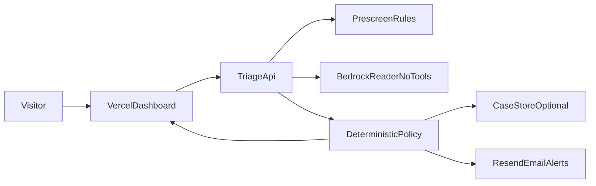
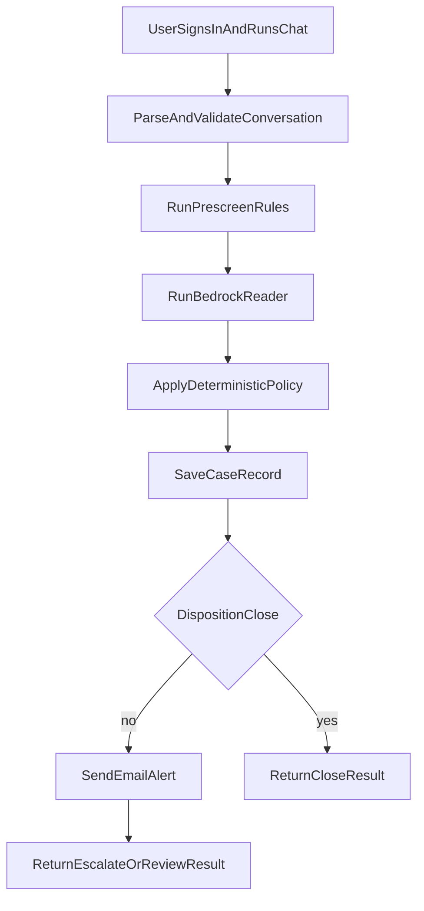

# Use Case 01: Market Conduct Alert Triage

This scenario demonstrates a hardened control boundary: untrusted employee chat text can influence findings, but cannot directly set the final verdict.

## Architecture Diagram

## Flow Diagram

## Why This Use Case Matters

- AI-directed instructions in chat are detected and escalated.
- Final decision is policy-driven code, not model free text.
- Alert email excludes raw transcript content.
